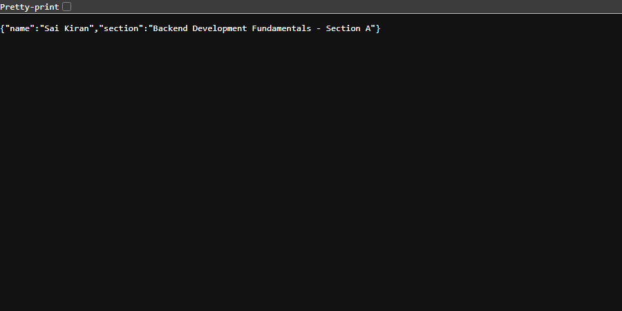
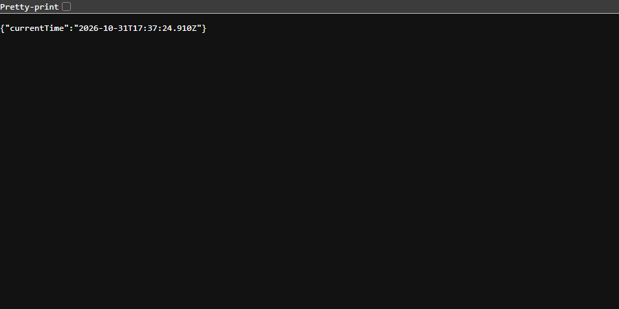

# Lab 1: Node.js and Express server

Sai Kiran · [Registration Number] · Section A  
Course: Backend Development Fundamentals (Year II Term II) · Aurora · Faculty: Joel Prashanth D

---

## Live Link

Not applicable (Running in local environment; local server tested and verified across all endpoints).

---

## How to Run

### Prerequisites
- Node.js (v18 or higher recommended)
- npm (Node Package Manager)

### Installation
Clone the repository and navigate to the `lab-01` directory:
```bash
git clone <repository-url>
cd backend-development-fundamentals/lab-01
npm install
```

### Environment Variables
Create a `.env` file in `lab-01/` (optional, falls back to default):
```env
PORT=3000
```

### Start Commands
To run the Express server:
```bash
npm start
```
or
```bash
node index.js
```

To run the plain built-in HTTP server:
```bash
npm run start:http
```
or
```bash
node http-server.js
```

---

## Endpoints / Scripts Table

### Express Server Routes (`index.js`)

| Method | Endpoint | Description | Status Code | Expected Output |
| :--- | :--- | :--- | :--- | :--- |
| `GET` | `/` | Welcome text message | `200 OK` | `Welcome to the Node.js and Express server!` |
| `GET` | `/about` | JSON response with developer name and section | `200 OK` | `{"name":"Sai Kiran","section":"..."}` |
| `GET` | `/time` | JSON response with current ISO timestamp | `200 OK` | `{"currentTime":"2026-..."}` |
| `ALL` | `*` (e.g. `/unknown`) | 404 handler for any unmapped route | `404 Not Found` | `404 Not Found: The requested resource does not exist.` |

### Plain HTTP Server (`http-server.js`)

| Method | Endpoint | Description | Status Code | Expected Output |
| :--- | :--- | :--- | :--- | :--- |
| `GET` | `/` | Built-in `http.createServer` response | `200 OK` | `Hello` |

---

## Screenshots

### 1. Plain HTTP Server (`GET /`)


### 2. Express Server Welcome (`GET /`)


### 3. Express Server About (`GET /about`)


### 4. Express Server Time (`GET /time`)


### 5. Express Server 404 Unknown Route (`GET /unknown`)


---

## package.json Fields Explanation

- `name`: The lowercase name of the package/module (`lab-01`).
- `version`: The current semantic version of the application (`1.0.0`).
- `description`: A brief summary of what the project does.
- `main`: The entry point file for the application (`index.js`).
- `scripts`: Custom CLI shortcut commands (e.g., `npm start`, `npm run start:http`).
- `keywords`: Array of search tags and categories related to the project.
- `author`: The developer or creator of the application.
- `license`: Software licensing model (`ISC`).
- `dependencies`: Third-party packages required for running the application in production (`express`).

---

## Viva Questions & Answers

1. **What is the difference between `package.json` and `node_modules`?**
   - `package.json` is a lightweight manifest file containing project metadata, configuration, scripts, and a list of direct dependencies with version ranges.
   - `node_modules` is the actual directory containing the downloaded source code of all installed packages and their transitive dependencies.

2. **What does `app.listen` do?**
   - `app.listen()` binds and listens for incoming HTTP connections on the specified network port and host address, transitioning the Express application into an active server.

3. **What do request and response represent?**
   - `req` (Request) is an object representing the HTTP request, providing headers, query parameters, URL path, body data, and HTTP method sent by the client.
   - `res` (Response) is an object representing the HTTP response sent back to the client, allowing status codes, headers, cookies, and data (JSON/text/HTML) to be returned.

---

## Notes: Problems Faced and How You Solved Them

- **Port collision / background node processes**: When switching between the plain HTTP server and the Express server on port 3000, process cleanup is necessary. Handled by ensuring previous server instances are stopped before starting another.
- **Handling wildcard 404 routes in Express**: Express 4 executes middleware sequentially. Placed the 404 catch-all middleware (`app.use((req, res) => { ... })`) at the very end after all defined endpoints, ensuring valid routes match first.
