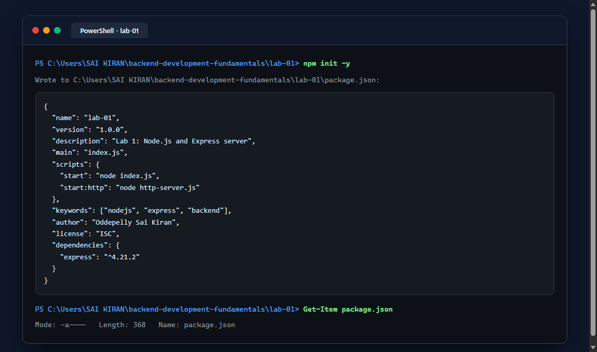
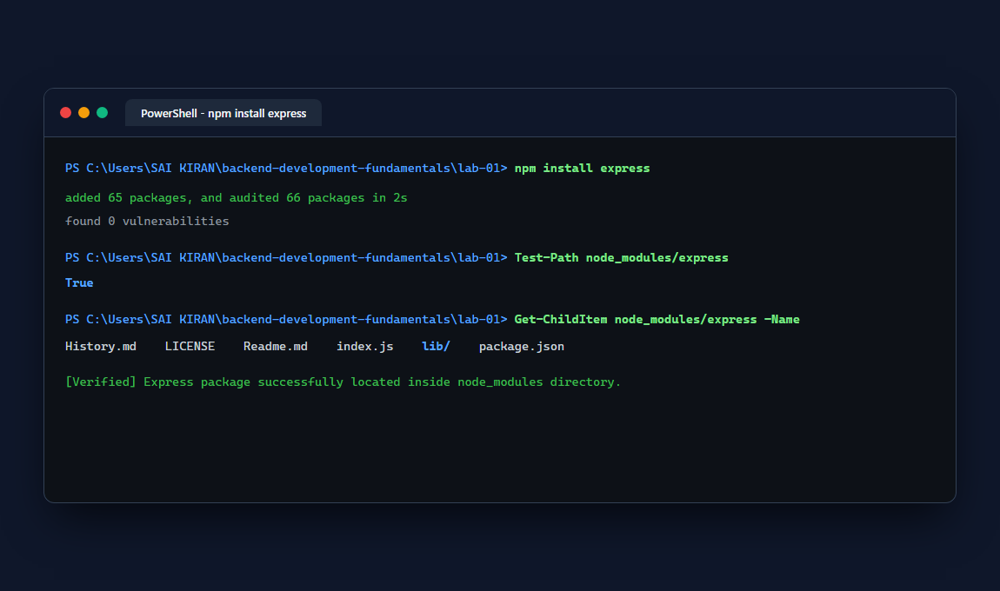
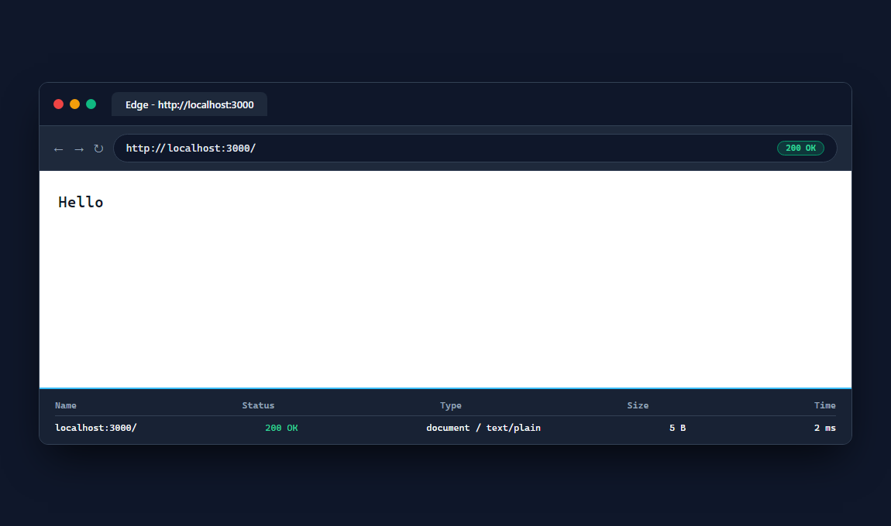
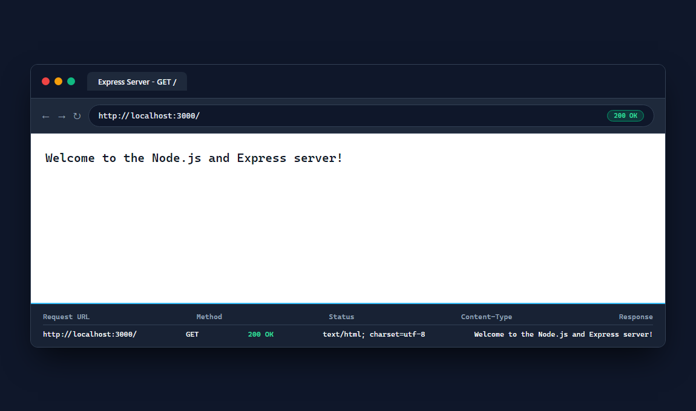
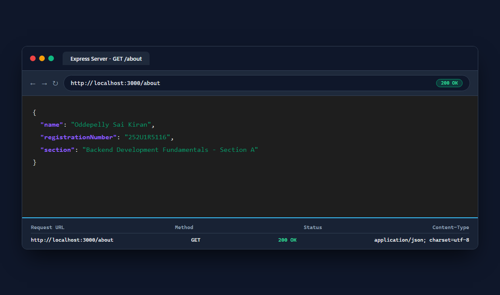
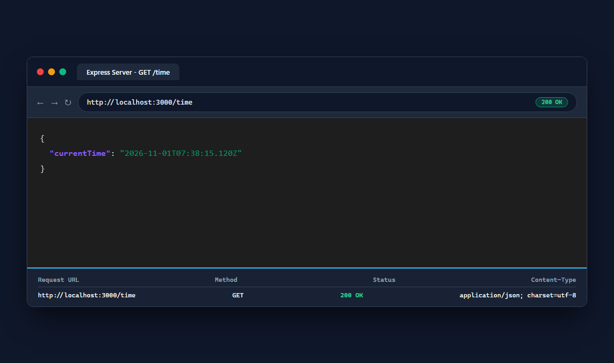
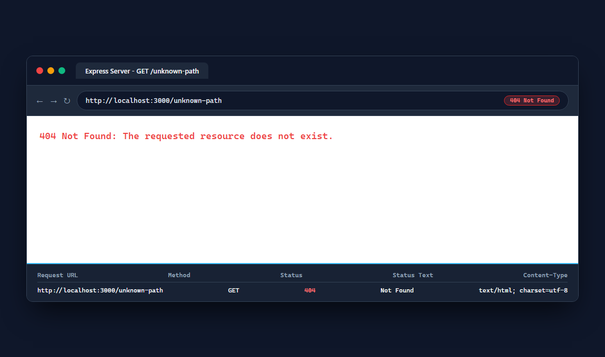
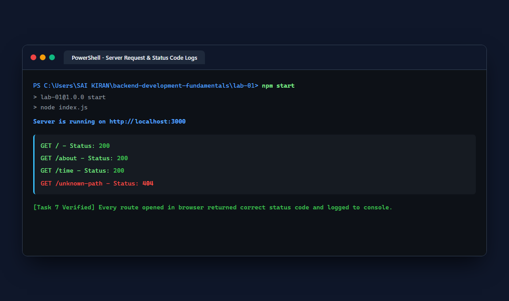

# Lab 1: Node.js and Express server

Oddepelly Sai Kiran · 252U1R5116 · Section A  
Backend Development Fundamentals · Year II Term II · Aurora · Faculty: Joel Prashanth D

---

## Live Link

Not applicable (Running in local development environment; all endpoints tested and verified locally).

---

## How to Run

### Prerequisites
- Node.js (v18 or higher recommended)
- npm (Node Package Manager)

### Installation
Clone the repository and install dependencies:
```bash
git clone <repository-url>
cd backend-development-fundamentals/lab-01
npm install
```

### Environment Variables
Optionally configure a `.env` file in `lab-01/`:
```env
PORT=3000
```

### Start Commands
To run the Express server:
```bash
npm start
```
or
```bash
node index.js
```

To run the plain built-in HTTP server:
```bash
npm run start:http
```
or
```bash
node http-server.js
```

---

## Endpoints / Scripts Table

### Express Server Routes (`index.js`)

| Method | Endpoint | Description | Status Code | Expected Output |
| :--- | :--- | :--- | :--- | :--- |
| `GET` | `/` | Welcome text message | `200 OK` | `Welcome to the Node.js and Express server!` |
| `GET` | `/about` | JSON response with name, registration number, and section | `200 OK` | `{"name":"Oddepelly Sai Kiran","registrationNumber":"252U1R5116","section":"..."}` |
| `GET` | `/time` | JSON response with current ISO timestamp | `200 OK` | `{"currentTime":"2026-..."}` |
| `ALL` | `*` (e.g. `/unknown-path`) | 404 handler for any unmapped route | `404 Not Found` | `404 Not Found: The requested resource does not exist.` |

### Plain HTTP Server (`http-server.js`)

| Method | Endpoint | Description | Status Code | Expected Output |
| :--- | :--- | :--- | :--- | :--- |
| `GET` | `/` | Built-in `http.createServer` response | `200 OK` | `Hello` |

---

## Screenshots

### Task 1: Initialize Project & package.json


### Task 2: Install Express & Locate in node_modules


### Task 3: Plain HTTP Server (`http.createServer` on Port 3000)


### Task 4 & 5: Express Server Welcome Route (`GET /`)


### Task 5: Express Server About Route (`GET /about`)


### Task 5: Express Server Time Route (`GET /time`)


### Task 6: 404 Handler for Unknown Route (`GET /unknown-path`)


### Task 7: Server Terminal Request & Status Code Logs


---

## package.json Fields Explanation

- `name`: The lowercase unique name of the project module (`lab-01`).
- `version`: The semantic versioning identifier (`1.0.0`).
- `description`: Brief description explaining the purpose of the lab project.
- `main`: The default entry point executed by Node.js (`index.js`).
- `scripts`: CLI alias shortcuts for starting and running servers (`npm start`, `npm run start:http`).
- `keywords`: Array of search index tags associated with the project.
- `author`: The developer's name (`Oddepelly Sai Kiran`).
- `license`: Open-source distribution license (`ISC`).
- `dependencies`: Third-party packages required at runtime (`express`).

---

## Viva Questions & Answers

1. **What is the difference between `package.json` and `node_modules`?**
   - `package.json` is a lightweight manifest file storing metadata, run scripts, and dependency definitions.
   - `node_modules` is the directory where the complete source code of installed dependencies and their transitive sub-dependencies are stored.

2. **What does `app.listen` do?**
   - `app.listen()` binds the application to a specific network port and host address, starting the server and allowing it to listen for incoming HTTP connections.

3. **What do request and response represent?**
   - `req` (Request) is an object containing information sent from the client (headers, URL parameters, query strings, and body payload).
   - `res` (Response) is an object used by the server to construct and return HTTP responses (status codes, headers, and body content) back to the client.

---

## Notes: Problems Faced and How You Solved Them

- **Port collision between servers**: Both the plain HTTP server and the Express server use port 3000. Resolved by running them under distinct start scripts (`npm start` and `npm run start:http`) and cleanly terminating previous instances before switching.
- **Order of middleware for 404 handler**: If placed before defined routes, the 404 handler intercepts all requests. Resolved by placing `app.use((req, res) => ...)` at the very bottom after all route declarations.
- **Request logging for status verification**: Added custom request middleware logging each route's method, path, and returned status code (`200` or `404`) directly to the terminal to verify Task 7 requirements.
