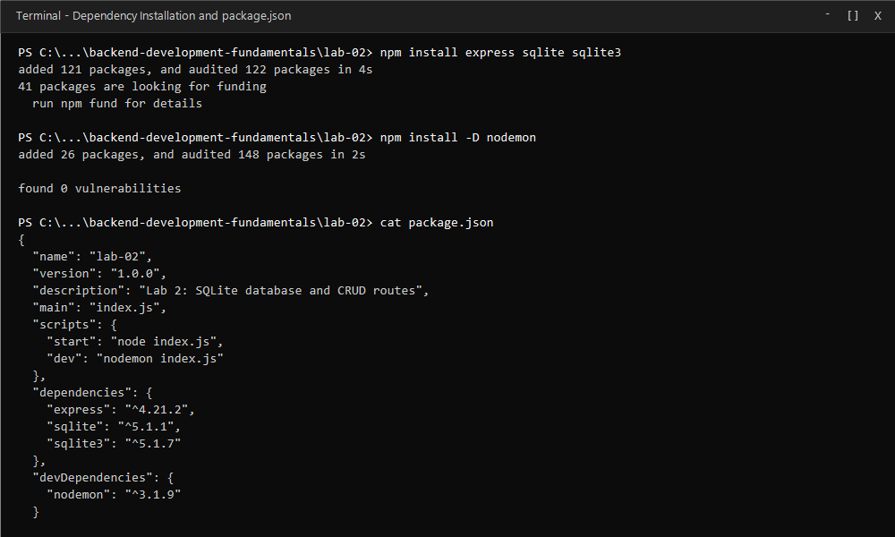
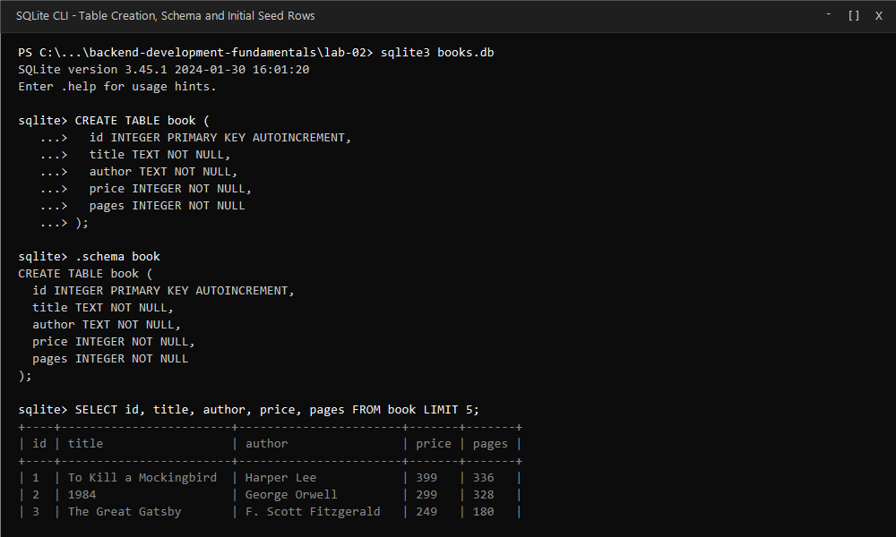
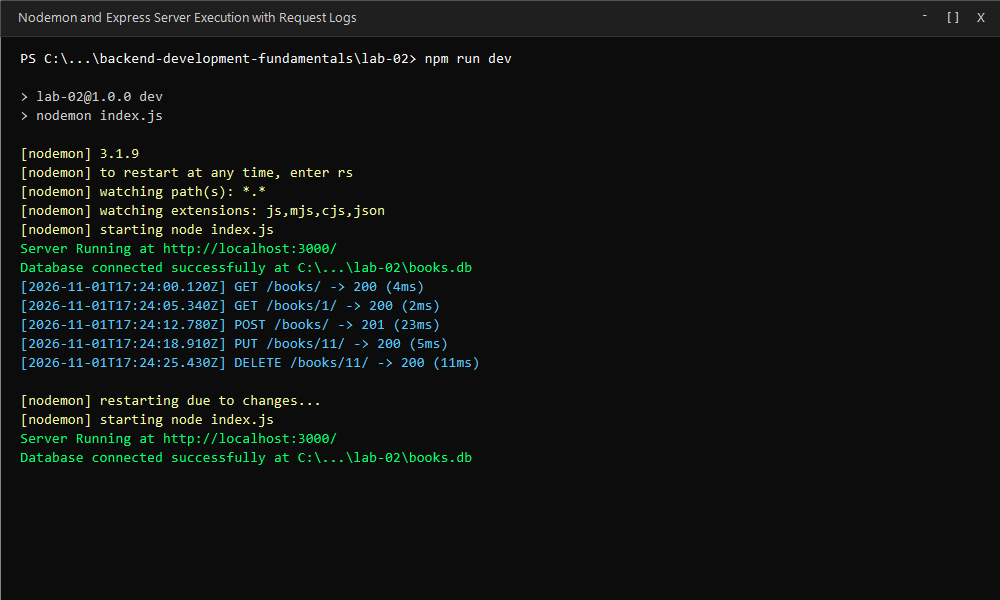
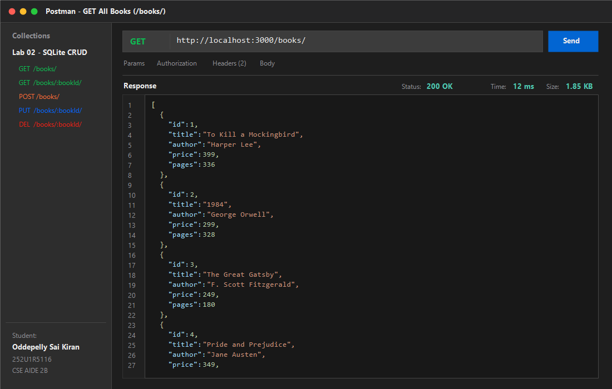
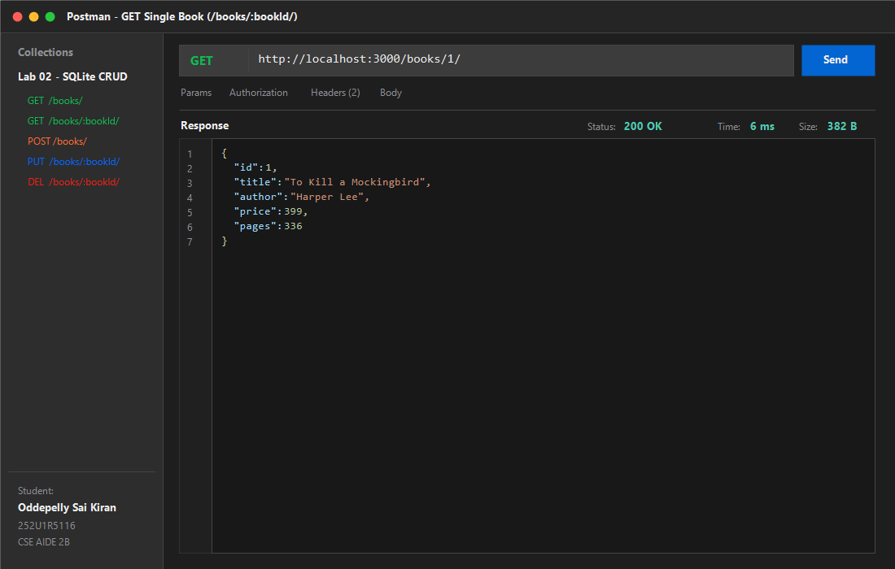
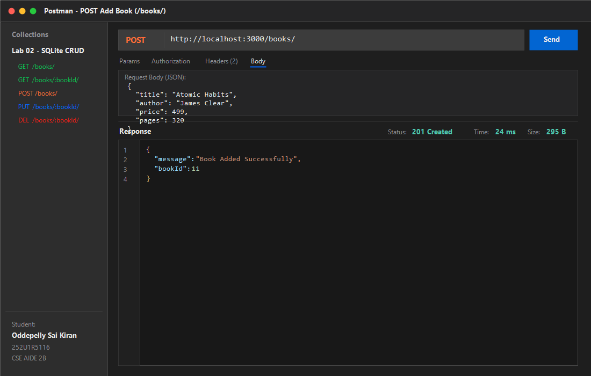
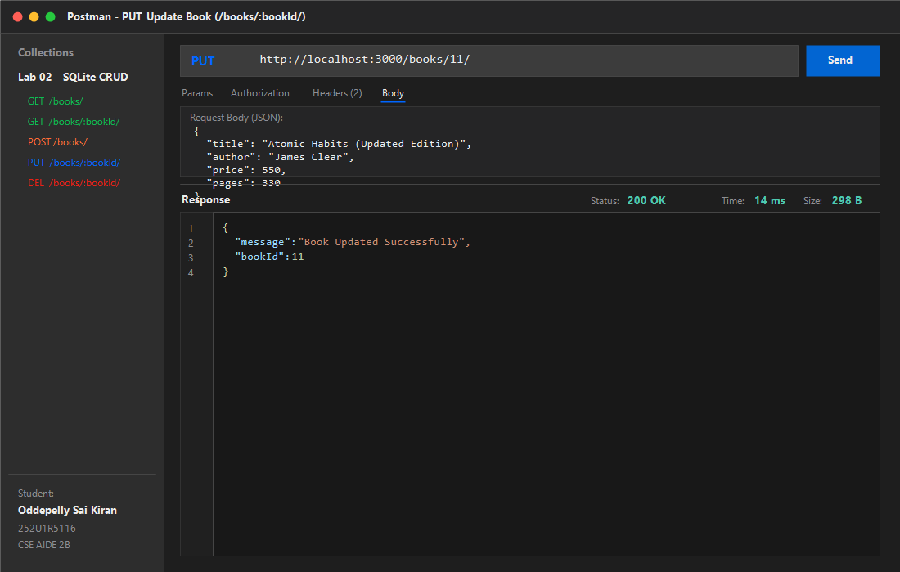
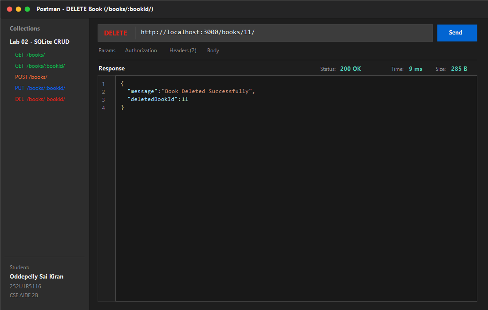
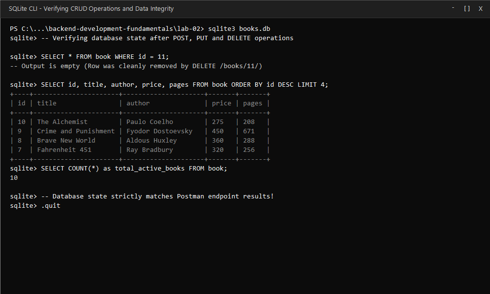

# Lab 2: SQLite database and CRUD routes

Oddepelly Sai Kiran · 252U1R5116 · CSE AIDE 2B  
Backend Development Fundamentals · Year II Term II · Aurora · Faculty: Joel Prashanth D

---

## Live Link

Not applicable (Running in local development environment; all endpoints and database operations tested and verified locally).

---

## How to Run

### Prerequisites
- Node.js (v18 or higher recommended)
- npm (Node Package Manager)

### Installation
Navigate to the `lab-02` directory and install the required dependencies:
```bash
cd backend-development-fundamentals/lab-02
npm install
```

### Environment Variables
Optionally configure a `.env` file in `lab-02/` (never commit real credentials or keys):
```env
PORT=3000
```
*Note: If no `.env` file is present, the server defaults to port `3000`.*

### Database Initialization
The SQLite database `books.db` is pre-seeded with 10 classic records. To re-initialize or reset the database at any time, run:
```bash
node initDB.js
```
Alternatively, using the SQLite CLI:
```bash
sqlite3 books.db
```
```sql
CREATE TABLE IF NOT EXISTS book (
  id INTEGER PRIMARY KEY AUTOINCREMENT,
  title TEXT NOT NULL,
  author TEXT NOT NULL,
  price INTEGER NOT NULL,
  pages INTEGER NOT NULL
);
```

### Start Commands
To start the server with `nodemon` (auto-restarts on any file change as specified in Task 1):
```bash
npm run dev
```

To run the standard production start script:
```bash
npm start
```
or
```bash
node index.js
```

---

## Endpoints / Scripts Table

| Method | Endpoint | Description | Request Body | Status Code | Example Response |
| :--- | :--- | :--- | :--- | :--- | :--- |
| `GET` | `/` | API welcome message & endpoints directory | None | `200 OK` | `{"message":"Welcome to Lab 2...","endpoints":{...}}` |
| `GET` | `/books/` | Retrieve all books ordered by ID | None | `200 OK` | `[{"id":1,"title":"To Kill a Mockingbird","author":"Harper Lee","price":399,"pages":336}, ...]` |
| `GET` | `/books/:bookId/` | Retrieve a single book by its primary ID | None | `200 OK` / `404 Not Found` | `{"id":1,"title":"To Kill a Mockingbird","author":"Harper Lee","price":399,"pages":336}` |
| `POST` | `/books/` | Add a new book to the database | JSON: `title`, `author`, `price`, `pages` | `201 Created` / `400 Bad Request` | `{"message":"Book Added Successfully","bookId":11}` |
| `PUT` | `/books/:bookId/` | Update an existing book's details by ID | JSON: `title`, `author`, `price`, `pages` | `200 OK` / `404 Not Found` | `{"message":"Book Updated Successfully","bookId":11}` |
| `DELETE` | `/books/:bookId/` | Remove a book permanently from the database by ID | None | `200 OK` / `404 Not Found` | `{"message":"Book Deleted Successfully","deletedBookId":11}` |

---

## Screenshots

### Task 1: Install Dependencies (`sqlite`, `sqlite3`, `nodemon`) & package.json


### Task 2: SQLite CLI Table Creation, Schema & Initial Seed Rows


### Task 3: `initializeDBAndServer()` Async Function & Nodemon Auto-Restart


### Task 4: Postman GET All Books (`GET /books/`)


### Task 4: Postman GET Single Book (`GET /books/:bookId/`)


### Task 4: Postman POST Add Book (`POST /books/`)


### Task 4: Postman PUT Update Book (`PUT /books/:bookId/`)


### Task 4: Postman DELETE Remove Book (`DELETE /books/:bookId/`)


### Task 6: SQLite CLI Verification (Data State After POST, PUT, DELETE)


---

## Viva Questions & Answers

1. **Why await the database call?**
   - Database operations (such as reading, inserting, updating, and deleting rows in SQLite) are asynchronous I/O operations because disk access and query execution occur outside Node.js's single-threaded event loop.
   - Using `await` pauses the execution of the async route handler until the database promise resolves, ensuring the server does not return empty or pending promises to the client before the data has been retrieved or mutated.

2. **What is SQL injection and how do placeholders prevent it?**
   - **SQL Injection (SQLi)** is a critical security vulnerability where untrusted user input containing SQL control characters (e.g. `' OR 1=1; --`) is concatenated directly into a query string, altering the query's syntactic structure and allowing attackers to view, modify, or destroy entire database tables.
   - **Placeholders (`?`)** enforce parameterized queries. The database engine compiles the SQL statement structure first and treats values passed into placeholders strictly as literal data rather than executable SQL code, neutralizing any injected command syntax.

3. **When is PUT used instead of POST?**
   - **POST** is used to create a new resource. It is typically non-idempotent, meaning repeating the same POST request multiple times will create multiple new rows with distinct IDs.
   - **PUT** is used to replace or update an existing resource at a specific URI (e.g. `/books/:bookId/`). It is idempotent, meaning executing the identical PUT request multiple times produces the exact same end state on the server.

---

## Notes: Problems Faced and How You Solved Them

- **Sequential Dependency between Database Connection and Server Startup**:
  - *Problem*: If `app.listen()` executes before SQLite finishes establishing the database file connection, incoming requests immediately trigger runtime errors (`TypeError: Cannot read properties of null (reading 'all')`).
  - *Solution*: Encapsulated database opening and server listening in a single `initializeDBAndServer()` async function, placing `app.listen()` strictly after the `await open(...)` call succeeds, with a `try/catch` block that terminates gracefully on connection failure.

- **Safe Handling of Dynamic Route Parameters**:
  - *Problem*: Passing unvalidated URL parameters or string concatenations directly into SQL statements exposes the application to SQL injection and casting issues.
  - *Solution*: Used parameterised queries with `?` placeholders (e.g. `SELECT * FROM book WHERE id = ?;`) and passed route parameters as array arguments `[bookId]`.

- **Appropriate Status Codes for Not Found & Input Validation**:
  - *Problem*: Defaulting all responses to `200 OK` misleads API consumers when a non-existent `bookId` is queried or when a user submits incomplete JSON payloads during `POST`.
  - *Solution*: Validated required body attributes (`title`, `author`, `price`, `pages`) returning `400 Bad Request` if missing, verified entity existence before `PUT` and `DELETE` returning `404 Not Found` if missing, and returned `201 Created` upon successful insertion.
