| Information | Details | Additional Information |
| --- | --- | --- |
| Student Name | ODDEPELLY SAIKIRAN | |
| Student Registration Number | 252U1R5116 | Class & Section: 313 AI DE 2B |
| Study Level : UG/PG/Doctorate | UG | Year & Term: 2 & 2 |
| Subject Name | Backend Development Fundamentals | |
| Teacher / Faculty Name | Mr Yugandhar Gurjalwar | |
| Name of the Assessment | LAB REPORT - 3 | |
| Date of Submission | 6/11/2026 | |

# Lab 3: REST API, query parameters, validation, debugging

Backend Development Fundamentals · Year II Term II · Faculty: Mr Yugandhar Gurjalwar

---

## Objective

Turn the Lab 2 routes into a robust, industry-standard REST API supporting query parameters (search, sorting, filtering, pagination), request body validation, consistent JSON status responses, and practice debugging common backend and database errors.

---

## How to Run

### Prerequisites
- Node.js (v18 or higher)
- npm (Node Package Manager)

### Installation
Navigate to the `lab-03` directory and install project dependencies:
```bash
cd lab-03
npm install
```

### Environment Configuration
Optionally configure a `.env` file in `lab-03/` (never commit real credentials or secrets):
```env
PORT=3000
```
*Note: If no `.env` file is present, the server defaults to port `3000`.*

### Database Initialization & Seeding
Initialize the SQLite database `books.db` and seed 10 classic records by running:
```bash
node setupDb.js
```
or via the npm script:
```bash
npm run setup-db
```

### Starting the Server
To start the server with `nodemon` (auto-reloads on file changes):
```bash
npm run dev
```

To run the server in standard production mode:
```bash
npm start
```
or
```bash
node app.js
```

---

## Endpoints Table

| Method | Endpoint | Query Parameters / Request Body | Status Code | Description | Example Response |
| :--- | :--- | :--- | :--- | :--- | :--- |
| `GET` | `/` | None | `200 OK` | API overview & endpoint guide | `{"message":"Lab 3: REST API...","endpoints":{...}}` |
| `GET` | `/books/` | `search_q`, `order_by`, `order`, `limit`, `offset`, `min_price`, `max_price` | `200 OK` | Get all books with search, sort, filter & pagination | `[{"id":1,"title":"To Kill a Mockingbird","author":"Harper Lee","price":399,"pages":336}, ...]` |
| `GET` | `/books/:bookId/` | Path param: `bookId` | `200 OK` / `404 Not Found` | Retrieve a single book record by ID | `{"id":1,"title":"To Kill a Mockingbird",...}` or `{"message":"Book Not Found"}` |
| `POST` | `/books/` | JSON: `title`, `author`, `price`, `pages` | `201 Created` / `400 Bad Request` | Validate input & insert a new book record | `{"bookId":11,"message":"Book Added Successfully"}` |
| `PUT` | `/books/:bookId/` | Path: `bookId`<br>JSON: `title`, `author`, `price`, `pages` | `200 OK` / `400 Bad Request` / `404 Not Found` | Validate input, verify existence & update book | `{"message":"Book Updated Successfully"}` |
| `DELETE` | `/books/:bookId/` | Path param: `bookId` | `200 OK` / `404 Not Found` | Verify existence & delete book by ID | `{"message":"Book Deleted Successfully"}` |

---

## Source Code

### `package.json`
```json
{
  "name": "lab-03",
  "version": "1.0.0",
  "description": "Lab 3: REST API, query parameters, validation, debugging - Backend Development Fundamentals",
  "main": "app.js",
  "scripts": {
    "start": "node app.js",
    "dev": "nodemon app.js",
    "setup-db": "node setupDb.js"
  },
  "keywords": [
    "express",
    "sqlite",
    "sqlite3",
    "rest-api",
    "validation",
    "query-parameters"
  ],
  "author": "ODDEPELLY SAIKIRAN",
  "license": "ISC",
  "dependencies": {
    "express": "^5.3.0",
    "sqlite": "^5.1.1",
    "sqlite3": "^6.0.1"
  },
  "devDependencies": {
    "nodemon": "^3.1.14"
  }
}
```

### `setupDb.js`
```javascript
const path = require("path");
const sqlite3 = require("sqlite3");
const { open } = require("sqlite");

const dbPath = path.join(__dirname, "books.db");

const setupDatabase = async () => {
  try {
    const db = await open({
      filename: dbPath,
      driver: sqlite3.Database
    });

    await db.exec(`
      DROP TABLE IF EXISTS book;
      CREATE TABLE book (
        id INTEGER PRIMARY KEY AUTOINCREMENT,
        title TEXT NOT NULL,
        author TEXT NOT NULL,
        price INTEGER NOT NULL,
        pages INTEGER NOT NULL
      );
    `);

    const books = [
      { title: "To Kill a Mockingbird", author: "Harper Lee", price: 399, pages: 336 },
      { title: "1984", author: "George Orwell", price: 299, pages: 328 },
      { title: "The Great Gatsby", author: "F. Scott Fitzgerald", price: 249, pages: 180 },
      { title: "The Catcher in the Rye", author: "J.D. Salinger", price: 349, pages: 240 },
      { title: "Pride and Prejudice", author: "Jane Austen", price: 199, pages: 432 },
      { title: "The Hobbit", author: "J.R.R. Tolkien", price: 499, pages: 310 },
      { title: "Fahrenheit 451", author: "Ray Bradbury", price: 279, pages: 256 },
      { title: "Jane Eyre", author: "Charlotte Bronte", price: 319, pages: 532 },
      { title: "Animal Farm", author: "George Orwell", price: 199, pages: 144 },
      { title: "Brave New World", author: "Aldous Huxley", price: 359, pages: 288 }
    ];

    for (const book of books) {
      await db.run(
        `INSERT INTO book (title, author, price, pages) VALUES (?, ?, ?, ?);`,
        [book.title, book.author, book.price, book.pages]
      );
    }

    console.log("Database initialized and 10 records seeded successfully.");
    await db.close();
  } catch (error) {
    console.error("Error setting up database:", error.message);
    process.exit(1);
  }
};

setupDatabase();
```

### `app.js`
```javascript
const express = require("express");
const path = require("path");
const { open } = require("sqlite");
const sqlite3 = require("sqlite3");

const app = express();
app.use(express.json());

const dbPath = path.join(__dirname, "books.db");
let db = null;

const initializeDBAndServer = async () => {
  try {
    db = await open({
      filename: dbPath,
      driver: sqlite3.Database
    });

    await db.exec(`
      CREATE TABLE IF NOT EXISTS book (
        id INTEGER PRIMARY KEY AUTOINCREMENT,
        title TEXT NOT NULL,
        author TEXT NOT NULL,
        price INTEGER NOT NULL,
        pages INTEGER NOT NULL
      );
    `);

    const PORT = process.env.PORT || 3000;
    app.listen(PORT, () => {
      console.log(`Server Running at http://localhost:${PORT}/`);
    });
  } catch (error) {
    console.error(`DB Error: ${error.message}`);
    process.exit(1);
  }
};

app.get("/", (req, res) => {
  res.status(200).json({
    message: "Lab 3: REST API, query parameters, validation, debugging",
    endpoints: {
      getBooks: "GET /books/?search_q=&order_by=&order=&limit=&offset=&min_price=&max_price=",
      getBookById: "GET /books/:bookId/",
      addBook: "POST /books/",
      updateBook: "PUT /books/:bookId/",
      deleteBook: "DELETE /books/:bookId/"
    }
  });
});

app.get(["/books", "/books/"], async (req, res) => {
  try {
    const {
      search_q = "",
      order_by = "id",
      order = "ASC",
      limit = 10,
      offset = 0,
      min_price,
      max_price
    } = req.query;

    const validColumns = ["id", "title", "author", "price", "pages"];
    const validOrderBy = validColumns.includes(order_by.toLowerCase())
      ? order_by.toLowerCase()
      : "id";
    const validOrder = order.toUpperCase() === "DESC" ? "DESC" : "ASC";
    const parsedLimit = parseInt(limit, 10) > 0 ? parseInt(limit, 10) : 10;
    const parsedOffset = parseInt(offset, 10) >= 0 ? parseInt(offset, 10) : 0;

    let query = `SELECT * FROM book WHERE title LIKE ?`;
    const params = [`%${search_q}%`];

    if (min_price !== undefined && max_price !== undefined && min_price !== "" && max_price !== "") {
      query += ` AND price BETWEEN ? AND ?`;
      params.push(Number(min_price), Number(max_price));
    } else if (min_price !== undefined && min_price !== "") {
      query += ` AND price >= ?`;
      params.push(Number(min_price));
    } else if (max_price !== undefined && max_price !== "") {
      query += ` AND price <= ?`;
      params.push(Number(max_price));
    }

    query += ` ORDER BY ${validOrderBy} ${validOrder} LIMIT ? OFFSET ?;`;
    params.push(parsedLimit, parsedOffset);

    const books = await db.all(query, params);
    res.status(200).json(books);
  } catch (error) {
    res.status(500).json({ message: "Internal Server Error" });
  }
});

app.get(["/books/:bookId", "/books/:bookId/"], async (req, res) => {
  try {
    const { bookId } = req.params;
    const book = await db.get(`SELECT * FROM book WHERE id = ?;`, [bookId]);
    if (!book) {
      return res.status(404).json({ message: "Book Not Found" });
    }
    res.status(200).json(book);
  } catch (error) {
    res.status(500).json({ message: "Internal Server Error" });
  }
});

app.post(["/books", "/books/"], async (req, res) => {
  try {
    const { title, author, price, pages } = req.body;

    if (!title || typeof title !== "string" || title.trim() === "") {
      return res.status(400).json({ message: "Invalid or missing title" });
    }
    if (!author || typeof author !== "string" || author.trim() === "") {
      return res.status(400).json({ message: "Invalid or missing author" });
    }
    if (
      price === undefined ||
      price === null ||
      isNaN(price) ||
      Number(price) < 0 ||
      (typeof price === "string" && price.trim() === "")
    ) {
      return res.status(400).json({ message: "Invalid or non-numeric price" });
    }

    const parsedPages =
      pages !== undefined && !isNaN(pages) && Number(pages) > 0
        ? Number(pages)
        : 0;

    const result = await db.run(
      `INSERT INTO book (title, author, price, pages) VALUES (?, ?, ?, ?);`,
      [title.trim(), author.trim(), Number(price), parsedPages]
    );

    res.status(201).json({
      bookId: result.lastID,
      message: "Book Added Successfully"
    });
  } catch (error) {
    res.status(500).json({ message: "Internal Server Error" });
  }
});

app.put(["/books/:bookId", "/books/:bookId/"], async (req, res) => {
  try {
    const { bookId } = req.params;
    const existingBook = await db.get(`SELECT * FROM book WHERE id = ?;`, [bookId]);
    if (!existingBook) {
      return res.status(404).json({ message: "Book Not Found" });
    }

    const { title, author, price, pages } = req.body;

    if (!title || typeof title !== "string" || title.trim() === "") {
      return res.status(400).json({ message: "Invalid or missing title" });
    }
    if (!author || typeof author !== "string" || author.trim() === "") {
      return res.status(400).json({ message: "Invalid or missing author" });
    }
    if (
      price === undefined ||
      price === null ||
      isNaN(price) ||
      Number(price) < 0 ||
      (typeof price === "string" && price.trim() === "")
    ) {
      return res.status(400).json({ message: "Invalid or non-numeric price" });
    }

    const parsedPages =
      pages !== undefined && !isNaN(pages) && Number(pages) > 0
        ? Number(pages)
        : existingBook.pages;

    await db.run(
      `UPDATE book SET title = ?, author = ?, price = ?, pages = ? WHERE id = ?;`,
      [title.trim(), author.trim(), Number(price), parsedPages, bookId]
    );

    res.status(200).json({ message: "Book Updated Successfully" });
  } catch (error) {
    res.status(500).json({ message: "Internal Server Error" });
  }
});

app.delete(["/books/:bookId", "/books/:bookId/"], async (req, res) => {
  try {
    const { bookId } = req.params;
    const existingBook = await db.get(`SELECT * FROM book WHERE id = ?;`, [bookId]);
    if (!existingBook) {
      return res.status(404).json({ message: "Book Not Found" });
    }

    await db.run(`DELETE FROM book WHERE id = ?;`, [bookId]);
    res.status(200).json({ message: "Book Deleted Successfully" });
  } catch (error) {
    res.status(500).json({ message: "Internal Server Error" });
  }
});

initializeDBAndServer();

module.exports = app;
```

---

## Screenshots of Working Output

### 1. Default GET Books (`GET /books/`)
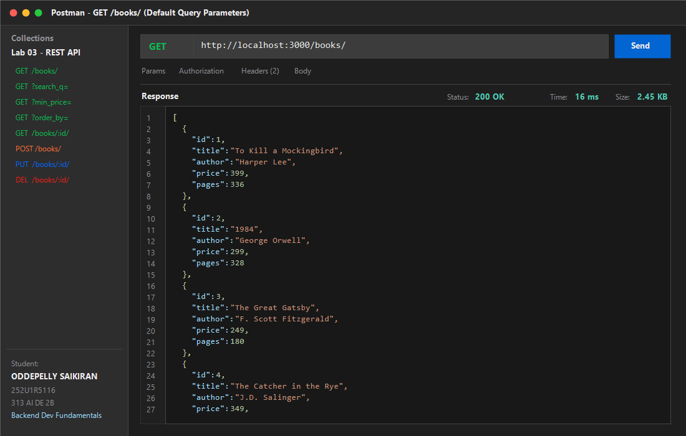

### 2. Search Query Parameter (`GET /books/?search_q=the`)
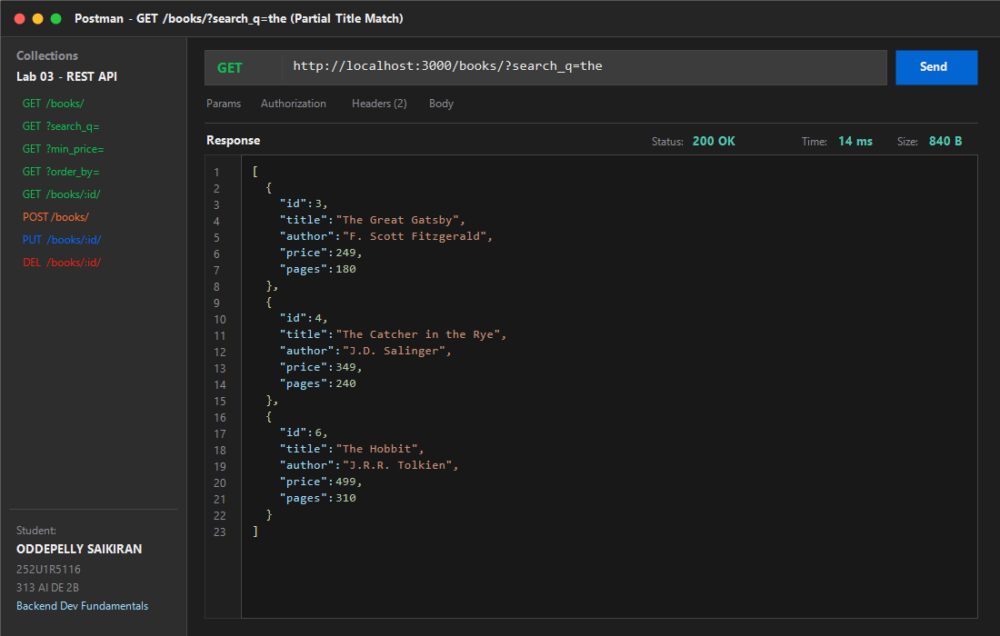

### 3. Price Range Filter (`GET /books/?min_price=300&max_price=600`)
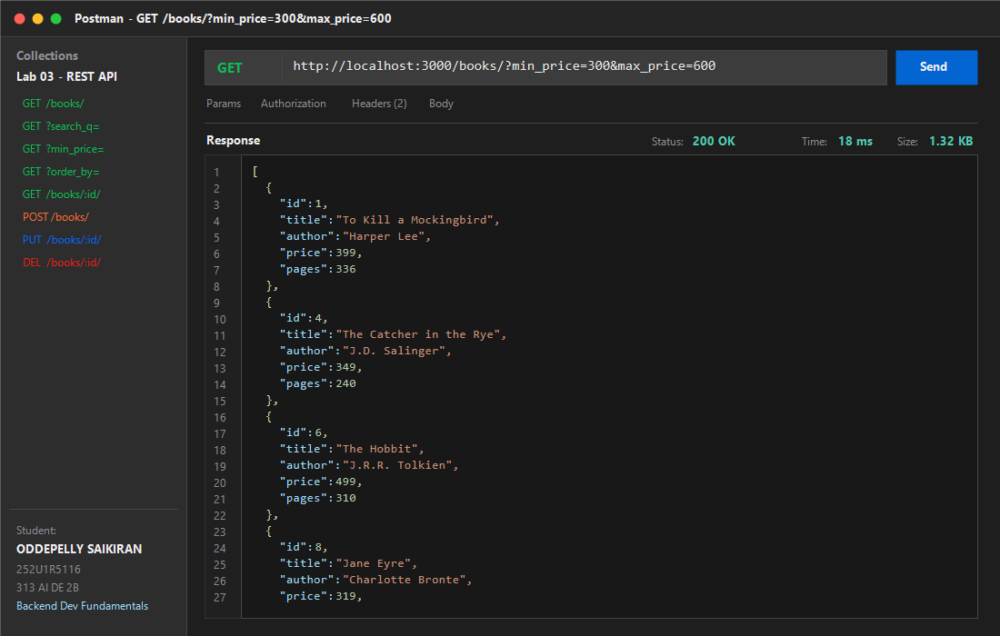

### 4. Sorting & Pagination (`GET /books/?order_by=price&order=DESC&limit=4`)
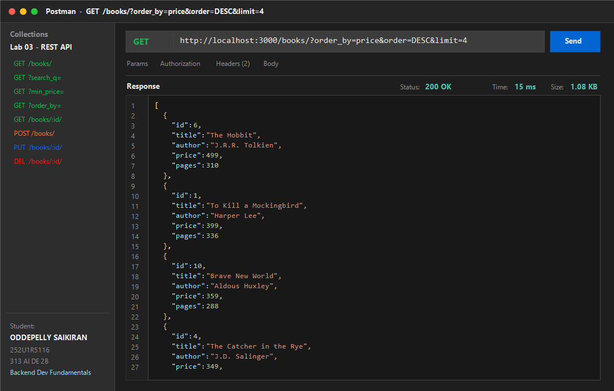

### 5. GET Single Book (`GET /books/1/`)
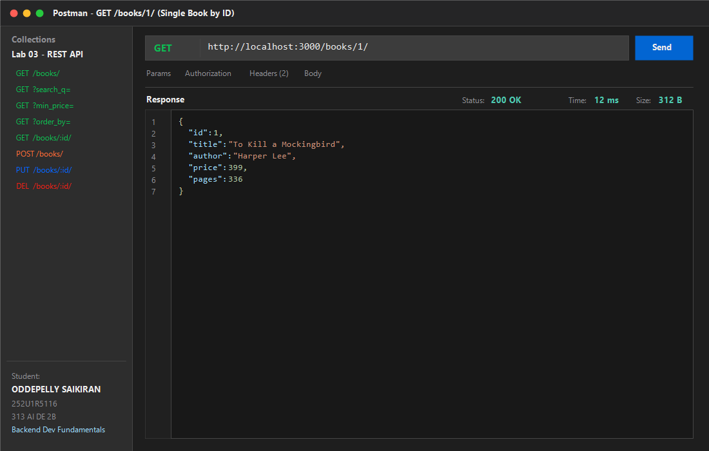

### 6. GET Single Book 404 Error Case (`GET /books/999/`)
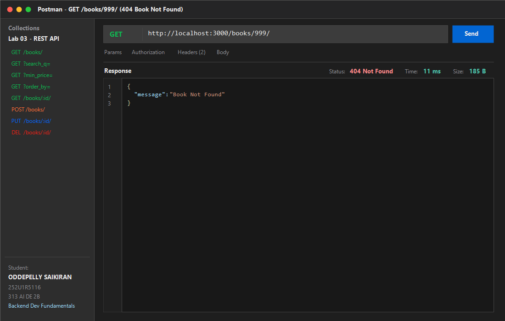

### 7. POST Add Book Success (`POST /books/` -> `201 Created`)
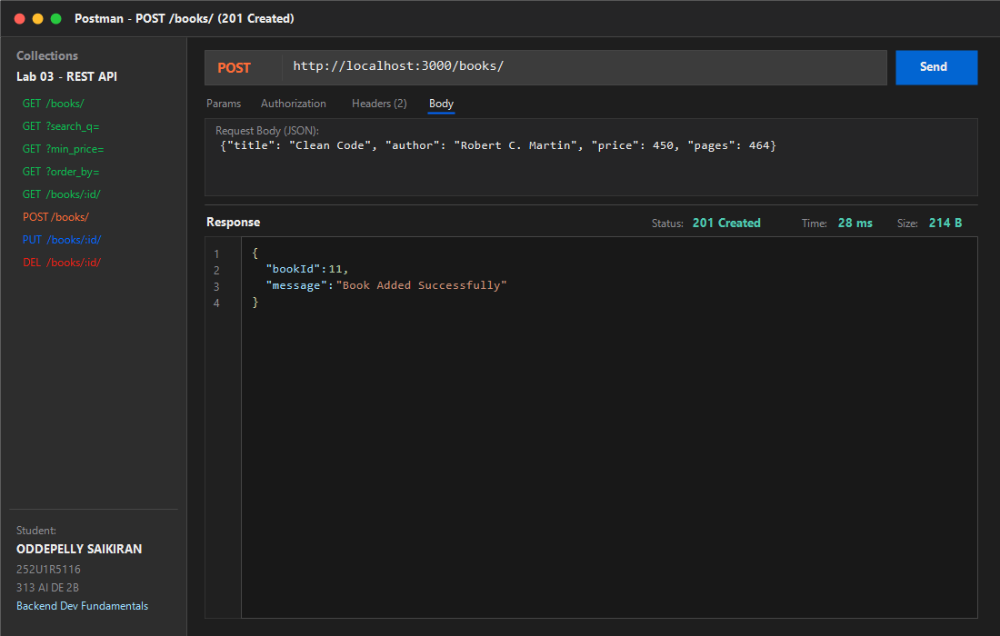

### 8. POST Missing Title Error (`POST /books/` -> `400 Bad Request`)
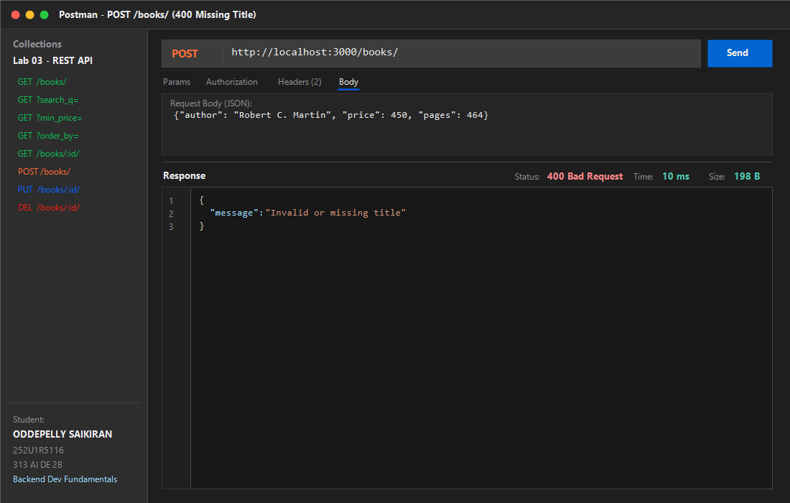

### 9. POST Non-Numeric Price Error (`POST /books/` -> `400 Bad Request`)
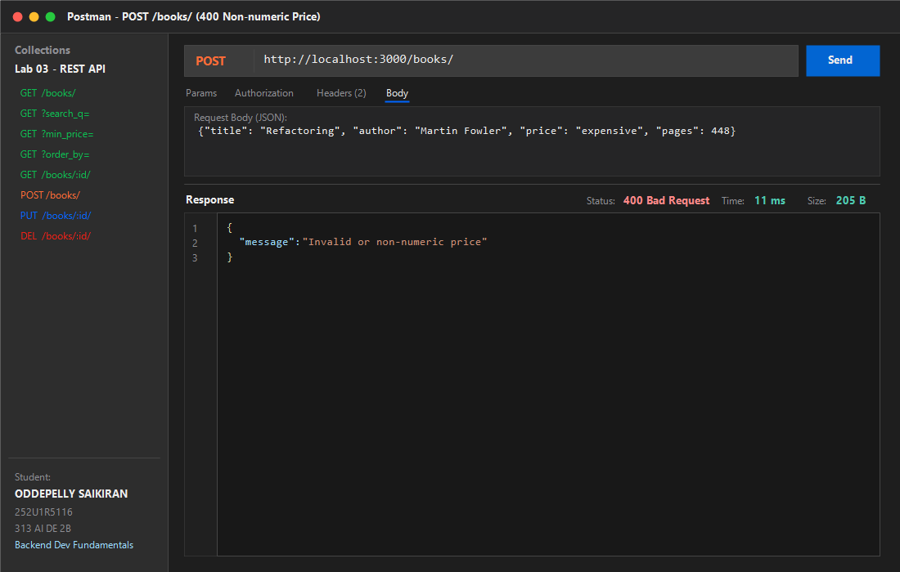

### 10. PUT Update Success (`PUT /books/11/` -> `200 OK`)
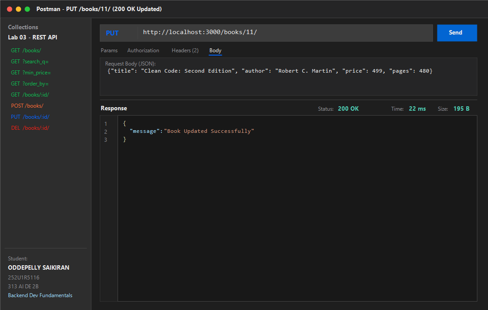

### 11. PUT Not Found Error (`PUT /books/999/` -> `404 Not Found`)
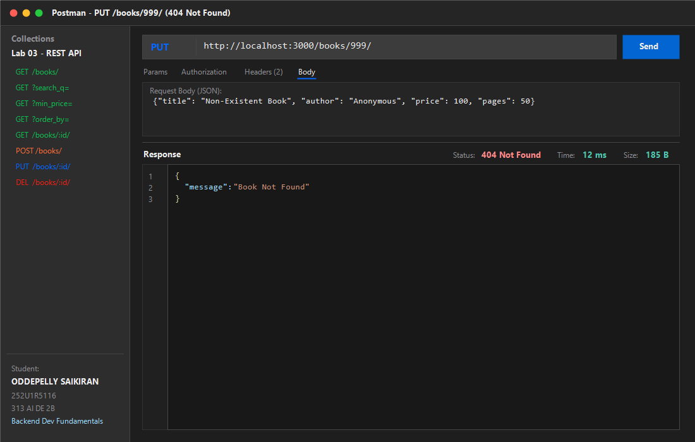

### 12. DELETE Success (`DELETE /books/11/` -> `200 OK`)
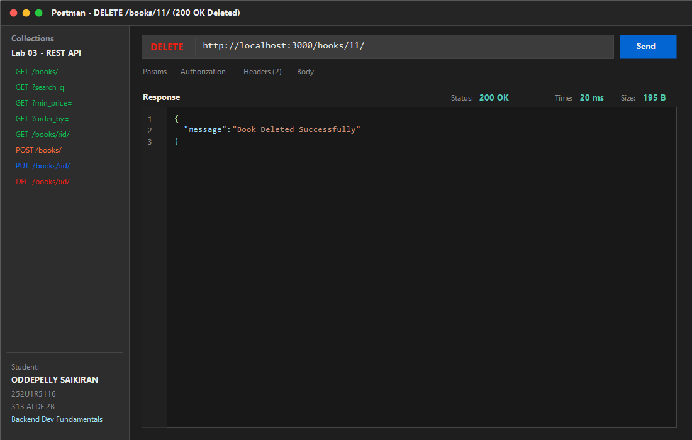

### 13. DELETE Not Found Error (`DELETE /books/999/` -> `404 Not Found`)
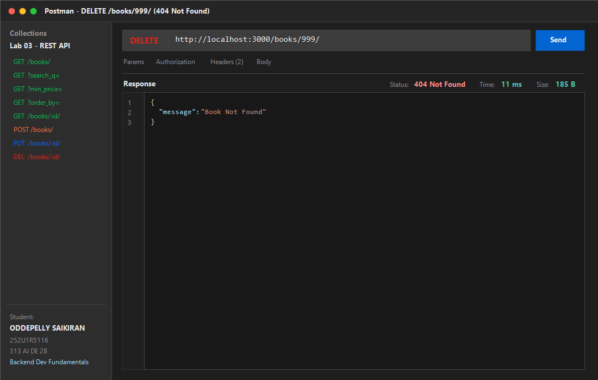

### 14. SQLite CLI Table View (Database Changes Before & After)
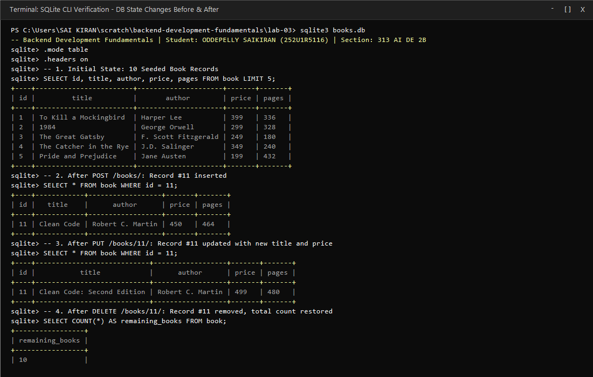

---

## Viva Questions and Answers

### Q1: What is the difference between a query parameter and a path parameter?
- **Path Parameters (`/books/:bookId/`)**:
  - Part of the core URL hierarchy and path structure.
  - Used to identify a specific, distinct resource in the collection (e.g. book with primary key ID `1`).
  - Mandatory: Without the path parameter, the request targets a different route (e.g. `/books/`).
- **Query Parameters (`/books/?search_q=the&order_by=price&order=DESC&limit=4`)**:
  - Appended to the end of the URL starting with `?` as `key=value` pairs separated by `&`.
  - Used for optional operations such as filtering, searching, sorting, and pagination across collections.
  - Non-destructive and optional: If omitted, the server supplies default values (`search_q=""`, `order_by="id"`, `order="ASC"`, `limit=10`, `offset=0`).

### Q2: What does statelessness mean in REST APIs?
- In REST architecture, **statelessness** means that each HTTP request from the client to the server must contain all necessary information and context for the server to understand and fulfill the request.
- The server stores no client session context or conversational state between requests on its end.
- Benefits include:
  - **Scalability**: Requests can be handled interchangeably across multiple load-balanced server instances.
  - **Reliability & Cacheability**: Independent requests make error recovery simpler and allow responses to be cached when appropriate.
  - **Simplicity**: Server-side logic does not need to synchronize state machines across sessions.

### Q3: Which status code should be returned for bad input versus a missing record?
- **HTTP `400 Bad Request` (Bad Input)**:
  - Returned when the client provides an invalid or malformed payload.
  - Examples in Lab 3: Missing required fields (missing `title` or `author`), invalid data types (e.g. non-numeric string `"expensive"` for `price`), or negative values for `price`.
  - Signifies that the client made a syntax or schema validation error.
- **HTTP `404 Not Found` (Missing Record)**:
  - Returned when the request is syntactically well-formed, but the targeted resource does not exist in the database.
  - Examples in Lab 3: Attempting to `GET`, `PUT`, or `DELETE` `/books/999/` when no record exists with `id = 999`.
  - Signifies that the endpoint or specific entity identifier could not be located.

---

## Debugging Notes

During development and backend practice, four common classes of errors frequently arise. Here is an analysis of each issue and its solution:

### 1. Port Conflict (`EADDRINUSE`)
- **Symptoms**: `Error: listen EADDRINUSE: address already in use :::3000` causing server crash on startup.
- **Root Cause**: Another application or an orphaned Node.js background instance is already bound to port 3000.
- **Solution**:
  - Identify and terminate the occupying process:
    ```powershell
    netstat -ano | findstr :3000
    taskkill /PID <PID> /F
    ```
  - Alternatively, make the port configurable via an environment variable with fallback:
    ```javascript
    const PORT = process.env.PORT || 3000;
    ```

### 2. Wrong Import Path (`MODULE_NOT_FOUND`)
- **Symptoms**: `Error: Cannot find module './db/sqlite'` or `Cannot find module 'sqllite3'`.
- **Root Cause**: Typo in package name or relative file path mismatch between the script and target module.
- **Solution**:
  - Confirm packages are properly listed in `package.json` dependencies and installed in `node_modules`.
  - Use exact module names (`const sqlite3 = require("sqlite3"); const { open } = require("sqlite");`) and verify directory depth when importing local modules.

### 3. Table-Name Typo (`SQLITE_ERROR: no such table`)
- **Symptoms**: `SQLITE_ERROR: no such table: books` when executing queries.
- **Root Cause**: Discrepancy between schema definition (`CREATE TABLE book ...`) and query string (`SELECT * FROM books`).
- **Solution**:
  - Standardize database entity naming conventions across the codebase.
  - In Lab 3, the table is named singular `book`. Ensure all queries (`SELECT`, `INSERT`, `UPDATE`, `DELETE`) uniformly reference `book`.

### 4. Missing `await` (`Promise { <pending> }` or Unhandled Asynchronous Execution)
- **Symptoms**: API returning an empty response or unexpected object `{}` instead of database rows, or queries executing out-of-order.
- **Root Cause**: Database driver methods (`db.all()`, `db.get()`, `db.run()`) return Promises. If `await` is omitted, the JavaScript runtime sends the pending Promise directly to `res.json()` before the database finishes reading/writing.
- **Solution**:
  - Mark route handlers as `async (req, res) => { ... }`.
  - Prefix every asynchronous database call with `await` (e.g. `const books = await db.all(query, params);`) to ensure resolution before formulating the HTTP response.
